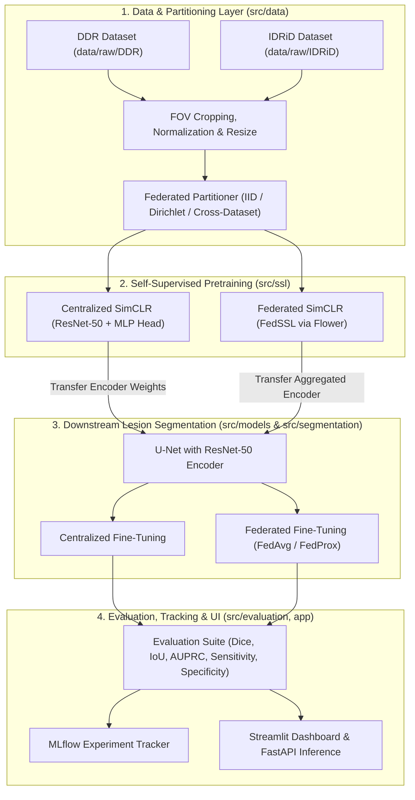

# FedMorphis System Architecture

## 1. Architectural Vision

**FedMorphis** is designed as a modular, configuration-driven research platform that decouples **data representation**, **backbone pretraining**, **pixel-level lesion segmentation**, **federated aggregation**, and **quantitative evaluation**. Every path is resolved dynamically relative to the project root using Python's `pathlib`, and every hyperparameter is externalized into composable YAML files under `configs/`.

---

## 2. Core Training & Evaluation Paradigms

A central requirement of FedMorphis is maintaining a strict conceptual and programmatic boundary between its five operational regimes:

### 2.1 Self-Supervised Pretraining (Centralized SSL)
- **Objective**: Learn generalizable retinal anatomical and lesion-relevant feature representations from **unlabeled** fundus images without using pixel-level masks.
- **Mechanism**:
  1. Each unlabeled fundus image $x$ is transformed via stochastic SimCLR augmentations (random resized cropping, color jitter, Gaussian blur, flips) into two correlated views $(\tilde{x}_i, \tilde{x}_j)$.
  2. A **ResNet-50 encoder** $f_\theta(\cdot)$ extracts feature maps and global pooled representations $h = f_\theta(\tilde{x})$.
  3. A non-linear **MLP projection head** $g_\phi(\cdot)$ maps $h$ to a 128-dimensional unit-hypersphere embedding $z = g_\phi(h)$.
  4. The network minimizes the **Normalized Temperature-scaled Cross-Entropy (NT-Xent)** contrastive loss (`configs/ssl.yaml`).
- **Artifact Produced**: Pretrained ResNet-50 encoder weights saved to `checkpoints/ssl/`. The projection head $g_\phi$ is discarded after pretraining.

### 2.2 Segmentation Fine-Tuning (Supervised Downstream Task)
- **Objective**: Predict pixel-wise multi-class probability maps for the four diabetic retinopathy lesion classes (`MA`, `HE`, `EX`, `SE`) plus background.
- **Mechanism**:
  1. A **U-Net** architecture (`configs/model.yaml`) is instantiated with a **ResNet-50 encoder** initialized from one of three sources:
     - Random initialization (scratch baseline)
     - Supervised ImageNet weights
     - SimCLR SSL pretrained retinal weights (`checkpoints/ssl/`)
  2. Skip connections link intermediate ResNet-50 stages (`layer1`–`layer4`) to a symmetric upsampling decoder.
  3. The full U-Net (or frozen-encoder followed by unfreezing) is trained on **labeled** image–mask pairs using a composite **Dice + Cross-Entropy / Focal Loss** to handle severe class imbalance (microaneurysms occupy $< 0.5\%$ of retinal pixels).
- **Artifact Produced**: Fine-tuned U-Net segmentation checkpoints in `checkpoints/segmentation/`.

### 2.3 Federated Training (Federated Supervised Segmentation)
- **Objective**: Train the U-Net segmentation model collaboratively across multiple decentralized clinical silos (clients) without exchanging raw patient images or ground-truth masks.
- **Mechanism**:
  1. **Flower (`flwr`)** orchestrates $K$ clients across $R$ communication rounds (`configs/federated.yaml`).
  2. In each round $r$, the central server broadcasts global U-Net parameters $W^{(r)}$ to participating clients.
  3. Each client $k$ performs $E$ local epochs of supervised segmentation training on its private labeled dataset $D_k$.
  4. Aggregation strategies:
     - **FedAvg**: Clients train with standard segmentation loss $\mathcal{L}_{\text{seg}}(W; D_k)$, and the server computes the sample-weighted average $W^{(r+1)} = \sum_k \frac{|D_k|}{|D|} W_k^{(r)}$.
     - **FedProx**: Adds a proximal regularization term $\frac{\mu}{2} \| W - W^{(r)} \|_2^2$ to the client's local objective to bound client drift across heterogeneous domains (e.g., DDR vs. IDRiD camera characteristics).
- **Artifact Produced**: Globally aggregated U-Net weights saved in `checkpoints/federated/`.

### 2.4 Federated SSL (Federated Self-Supervised Pretraining)
- **Objective**: Pretrain the ResNet-50 encoder + SimCLR projection head across distributed **unlabeled** institutional datasets before any supervised segmentation takes place.
- **Mechanism**:
  1. Each client $k$ runs local SimCLR contrastive training (NT-Xent loss) on its private unlabeled fundus photographs for $E$ local epochs.
  2. Clients transmit only their updated encoder $(\theta_k)$ and projection head $(\phi_k)$ parameters to the Flower server.
  3. The server aggregates $(\theta^{(r+1)}, \phi^{(r+1)})$ via **FedAvg** or **FedProx** over $R$ rounds.
  4. Once Federated SSL converges, the aggregated ResNet-50 encoder $\theta^*$ is extracted and used to initialize the U-Net encoder for either **local fine-tuning** at a single hospital or **federated segmentation fine-tuning** across hospitals.
- **Key Distinction**: Unlike *Federated Supervised Training* (which requires pixel annotations at every client), *Federated SSL* leverages unannotated clinical archives across hospitals to build a shared foundation encoder privately.

### 2.5 Comparative Evaluation
- **Objective**: Rigorously benchmark segmentation accuracy, rare-lesion sensitivity, and cross-dataset generalization across all training regimes.
- **Mechanism**:
  - Evaluates trained U-Net checkpoints on held-out test splits of both **DDR** and **IDRiD** (`configs/experiment.yaml`).
  - Computes per-lesion and macro-averaged metrics:
    - **Dice Similarity Coefficient (DSC)**
    - **Intersection over Union (IoU / Jaccard)**
    - **Area Under the Precision-Recall Curve (AUPRC)** (standard benchmark metric for IDRiD/DDR due to extreme background dominance)
    - **Sensitivity (Recall)** and **Specificity**
  - Logs metrics, confusion statistics, and qualitative prediction overlays to **MLflow** (`experiments/mlruns`) for visualization in the **Streamlit** dashboard.

---

## 3. Summary Comparison of Paradigms

| Paradigm | Data Used | Supervision | Architecture Trained | Training Topology | Output Checkpoint |
| :--- | :--- | :--- | :--- | :--- | :--- |
| **Centralized SSL** | Pooled unlabeled fundus images | Self-supervised (NT-Xent) | ResNet-50 + SimCLR MLP Head | Single node | `checkpoints/ssl/` |
| **Segmentation Fine-Tuning** | Pooled labeled images + lesion masks | Supervised (Dice + Focal/CE) | U-Net (ResNet-50 encoder) | Single node | `checkpoints/segmentation/` |
| **Federated Supervised** | Decentralized labeled client splits | Supervised (Dice + Focal/CE) | U-Net (ResNet-50 encoder) | Multi-client Flower (FedAvg / FedProx) | `checkpoints/federated/` |
| **Federated SSL (FedSSL)** | Decentralized unlabeled client splits | Self-supervised (NT-Xent) | ResNet-50 + SimCLR MLP Head | Multi-client Flower (FedAvg / FedProx) | `checkpoints/ssl/` & `checkpoints/federated/` |
| **Evaluation** | Held-out DDR & IDRiD test sets | Ground-truth comparison | Frozen U-Net inference | Deterministic test runner | `experiments/` metrics & MLflow |

---

## 4. Module Responsibilities (`src/`)

- `src/utils/`: Project root discovery (`pathlib`), YAML configuration loading and validation, deterministic seeding, and structured logging.
- `src/data/`: Dataset wrappers for DDR and IDRiD, retinal FOV mask generation, Albumentations transforms, SimCLR dual-view generators, and client partitioners.
- `src/models/`: Modular `ResNet50UNet` encoder-decoder (`src/models/unet.py`), multilabel `BCEDiceLoss` & `SoftDiceLoss` (`src/models/losses.py`), and `SegmentationMetricTracker` (`src/models/metrics.py`).
- `src/engine/`: Reusable `SupervisedSegmentationTrainer` (`src/engine/trainer.py`) with AMP mixed precision, gradient norm clipping, checkpoint persistence/resume, and test-split leakage prevention.
- `src/ssl/`: NT-Xent loss implementation and SimCLR epoch runner.
- `src/segmentation/`: Multi-label segmentation pipeline exports and downstream fine-tuning utilities.
- `src/federated/`: Flower `NumPyClient` subclasses for both SSL and Segmentation, custom `FedAvg` / `FedProx` strategy wrappers, and simulation runners.
- `src/evaluation/`: Per-class (`MA`, `HE`, `EX`, `SE`) and macro-averaged Dice, IoU, Precision, Recall, Sensitivity, and Specificity evaluators with explicit empty-mask policies.
- `src/experiments/`: End-to-end experiment orchestrator linking YAML configs to MLflow runs.

